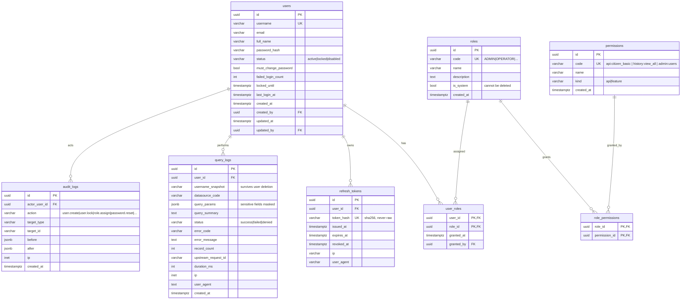
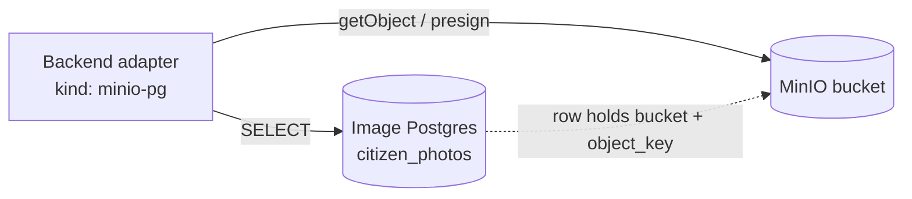

# Tham khảo: Database Schema & ERD

> Spec (h) yêu cầu Database + ERD design doc. Đây là nó. Phase 02 implements nó.
> All tables trong Postgres schema `app`. **image database là EXTERNAL** (given bởi leader,
> MinIO + Postgres) — chúng tôi chỉ READ nó; nó NOT trong ERD này ngoại trừ như dashed external box.

## ERD



## Bên ngoài (chỉ đọc, KHÔNG thuộc về chúng tôi)



Assumed external shape (TO BE CONFIRMED với Egor — xem unresolved questions):
`citizen_photos(id, cccd, bucket, object_key, mime_type, captured_at, source, created_at)`
Until confirmed, Phase 04 seeds **mock** table có shape này + seeds MinIO với sample images.

## Ghi chú về bảng

| Table | Purpose | Key decisions |
|---|---|---|
| `users` | Spec (b) admin user mgmt | `status` drives login refusal. `locked_until` supports auto-lock sau N failed logins (separate từ admin lock). `password_hash` = argon2id. |
| `roles` / `user_roles` | Spec (c): user có 1..N roles | `is_system` protects bootstrap ADMIN role từ deletion. |
| `permissions` | Spec (c): role grants per-API access | Rows **auto-synced từ `config.json`** tại boot: mỗi datasource `permissionCode` becomes `api` permission. Feature perms (`history:view_own`, `history:view_all`, `admin:users`, `admin:roles`) là seeded constants. Điều này keeps config.json và DB trong lockstep với zero manual steps. |
| `refresh_tokens` | Fast revocation | Admin locks user → delete all rows của họ → next refresh fails. Access token TTL kept short nên lock takes effect trong minutes. |
| `query_logs` | Spec (e) | `username_snapshot` vì spec (f) lets admin filter history bởi user forever, ngay cả nếu user later removed. `query_params` masked per `sensitive` flag trong config. `status='denied'` cũng logged — permission rejection là security-relevant. |
| `audit_logs` | Spec (g): *thao tác quản trị user/role cũng phải ghi log* | `before`/`after` jsonb diff, password hashes NEVER stored trong either. |

## Index

```sql
CREATE INDEX ON app.query_logs (user_id, created_at DESC);
CREATE INDEX ON app.query_logs (datasource_code, created_at DESC);
CREATE INDEX ON app.query_logs (created_at DESC);
CREATE INDEX ON app.audit_logs (actor_user_id, created_at DESC);
CREATE INDEX ON app.audit_logs (target_type, target_id);
CREATE INDEX ON app.refresh_tokens (user_id) WHERE revoked_at IS NULL;
```

Tại 50 users cái này là more than sufficient; không partitioning cần (YAGNI). Revisit chỉ nếu
`query_logs` exceeds ~10M rows.

## Dữ liệu seed (Phase 02)

- Roles: `ADMIN` (all perms, `is_system=true`), `OPERATOR` (api perms + `history:view_own`), `AUDITOR` (`history:view_all`, không api perms).
- Một bootstrap admin user, password từ env `BOOTSTRAP_ADMIN_PASSWORD`, `must_change_password=true`.
  Bao giờ không hardcoded default password.
