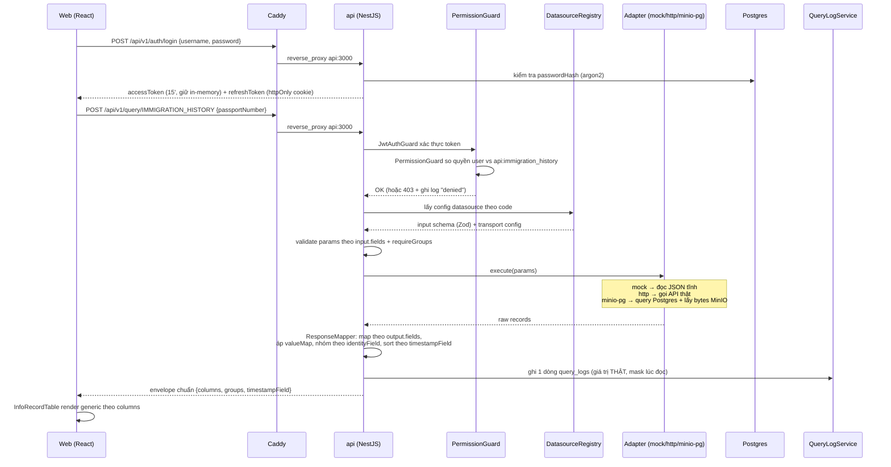
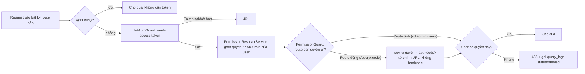
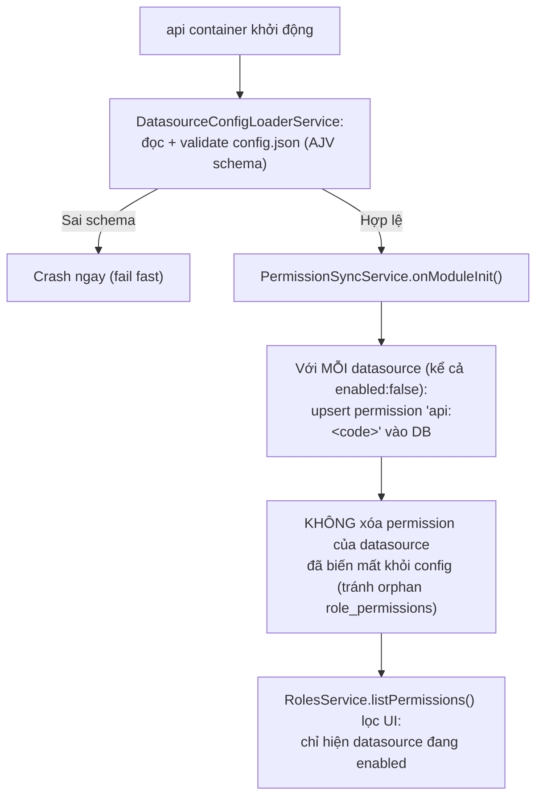
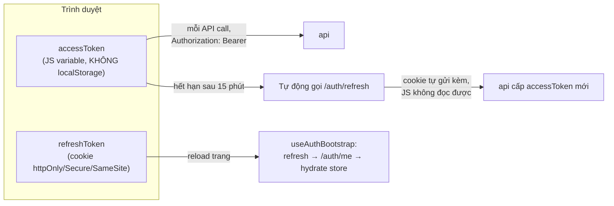
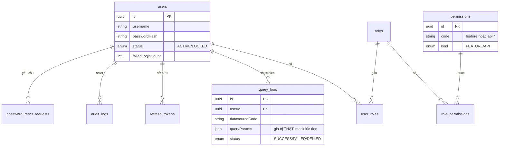
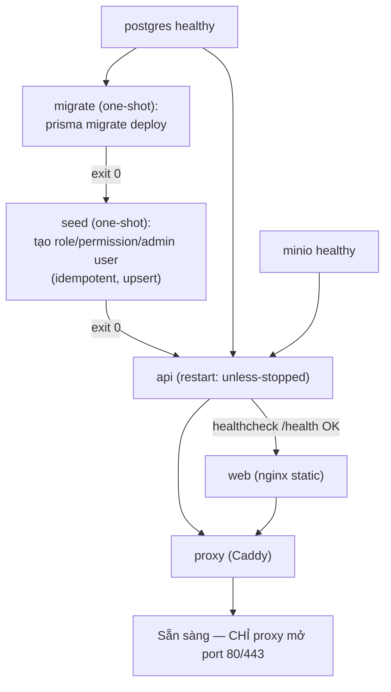

# Visual Explanation: Kiến trúc hệ thống & cách hoạt động

## Overview

APP Tra cứu dữ liệu là cổng tra cứu công dân nội bộ (~50 người dùng). Tư tưởng thiết kế xuyên
suốt: **config-driven** — `config/config.json` là "bộ não" quyết định mọi nguồn tra cứu (input
cần gì, output trả gì, gọi API thật hay mock), code xử lý hoàn toàn generic, không hardcode tên
field nào. Thêm 1 API tra cứu mới = sửa JSON, không sửa code.

Stack: NestJS (api) + React (web) + Postgres (dữ liệu quản trị) + MinIO (ảnh) + Caddy (cổng
vào duy nhất, tự mã hóa HTTPS nội bộ) — đóng gói hoàn toàn bằng Docker Compose.

## Quick View (ASCII)

```
                    ┌─────────────────────────────────────────┐
                    │         Trình duyệt (LAN/VPN nội bộ)      │
                    └───────────────────┬───────────────────────┘
                                        │ HTTPS (tự ký nội bộ, không ra internet)
                    ╔═══════════════════▼═══════════════════════╗
                    ║  proxy (Caddy) — CỔNG VÀO DUY NHẤT          ║
                    ║  network: frontend                          ║
                    ╚═══════════╦═══════════════════╦═════════════╝
                /api/v1/* │                          │ mọi path khác
                          ▼                          ▼
              ┌──────────────────┐         ┌──────────────────┐
              │  api (NestJS)     │         │  web (nginx)      │
              │  network:         │         │  network:frontend │
              │  frontend+backend │         │  (file tĩnh React)│
              └─────────┬─────────┘         └──────────────────┘
                        │ network: backend (không lộ ra ngoài)
            ┌───────────┼────────────┐
            ▼                        ▼
  ┌──────────────────┐    ┌──────────────────┐
  │ postgres :5432     │    │ minio :9000       │
  │ (users/roles/      │    │ (ảnh công dân,    │
  │  query_logs/...)   │    │  object storage)  │
  └──────────────────┘    └──────────────────┘
```

**2 network tách biệt = ranh giới bảo mật:** `backend` (postgres, minio, api — không IP nào lộ
ra host) và `frontend` (proxy, web, api). `api` có mặt ở cả 2 — là cầu nối DUY NHẤT giữa vùng
công khai và vùng dữ liệu nhạy cảm.

## Detailed Flow

### 1. Một lượt tra cứu đầy đủ (đăng nhập → tra cứu → ghi lịch sử)



### 2. RBAC — một điểm chốt quyền duy nhất



Thêm 1 datasource mới trong `config.json` → quyền `api:<code>` **tự động** được bảo vệ, không
sửa route nào — vì route `/query/:code` tự suy quyền từ `:code`.

### 3. Vòng đời permission `api:*` — đồng bộ tự động lúc boot



### 4. Auth — access token vs refresh token



Tại sao tách 2 loại: access token sống ngắn (15') để nếu lộ thì thiệt hại giới hạn thời gian;
refresh token sống dài (7 ngày) nhưng không bao giờ chạm tới JavaScript (httpOnly) nên XSS không
lấy được nó.

### 5. Database — các bảng chính và quan hệ



`citizen_photos` (metadata ảnh MinIO) là DB **ngoài** schema `app`, chỉ đọc.

### 6. Docker Compose — thứ tự khởi động 7 container



## Key Concepts

1. **Config-driven = 1 nguồn sự thật.** `config/config.json` định nghĩa `input.fields` (form
   nhập), `output.fields` (bảng kết quả, kèm `valueMap`/`sensitive`/`emphasize`/`iconMap`),
   `transport` (mock/http/minio-pg). Code (`buildInputSchema`, `ResponseMapperService`,
   `InfoRecordTable`) đọc field list tại runtime — **không có `citizenId` hardcode ở đâu**.

2. **1 điểm chốt quyền (`PermissionGuard`), không rải rác.** Dù có 50 route, chỉ 1 nơi quyết
   định "được phép hay không". Route động tự suy quyền từ `:code` nên không bao giờ quên bảo vệ
   datasource mới.

3. **Mask dữ liệu nhạy cảm ở READ-TIME, không phải WRITE-TIME** (mới sửa gần đây). `query_logs`
   lưu giá trị thật — `HistoryService` mới là nơi quyết định hiện full hay `***` tùy quyền
   `history:view_sensitive` của người đang xem.

4. **"Never hard-delete" cho permission.** Tắt 1 datasource (`enabled:false`) không xóa
   permission trong DB — tránh mất ý nghĩa audit log cũ và orphan `role_permissions`. UI chỉ lọc
   hiển thị, dữ liệu gốc vẫn còn.

5. **TLS nội bộ, không phụ thuộc internet.** `docker/Caddyfile` dùng `tls internal` — Caddy tự
   làm CA, tự ký, không bao giờ gọi Let's Encrypt. App chạy được hoàn toàn trong mạng cô lập.

6. **Image Docker không chứa `config.json`.** Nó được bind-mount từ host (`./config:/repo/config:ro`)
   — đây là lý do "thêm datasource = sửa file + restart, không rebuild image" là có thật, không
   chỉ là lời hứa trên giấy.

## Code Example

`config/config.json` — 1 datasource định nghĩa đủ mọi thứ code cần, không gì khác:

```json
{
  "code": "IMMIGRATION_HISTORY",
  "permissionCode": "api:immigration_history",
  "transport": { "kind": "mock", "dataFile": "mock-data/immigration-history.json" },
  "input": {
    "fields": [{ "name": "passportNumber", "label": "Số hộ chiếu", "type": "string" }],
    "requireGroups": [["passportNumber"], ["fullName", "dob", "gender"]]
  },
  "output": {
    "identityField": "passportNumber",
    "timestampField": "eventAt",
    "fields": [
      { "name": "direction", "from": "xuatNhap", "type": "enum",
        "valueMap": { "X": "Xuất cảnh", "N": "Nhập cảnh" },
        "emphasize": true, "iconMap": { "Xuất cảnh": "arrow-up-right" } }
    ]
  }
}
```

`PermissionGuard` suy quyền động từ route — không có `if (code === 'IMMIGRATION_HISTORY')` nào:

```ts
// apps/api/src/datasources/datasources.controller.ts
@RequirePermission()                 // rỗng = chỉ cần đăng nhập, quyền thật tính runtime
@Get(':code')
async getOne(@CurrentUser() user, @Param('code') code: string) {
  const permissions = await this.permissionResolver.getEffectivePermissions(user.id);
  if (!permissions.has(apiPermissionCode(code))) throw new ForbiddenException(...);
}
```
