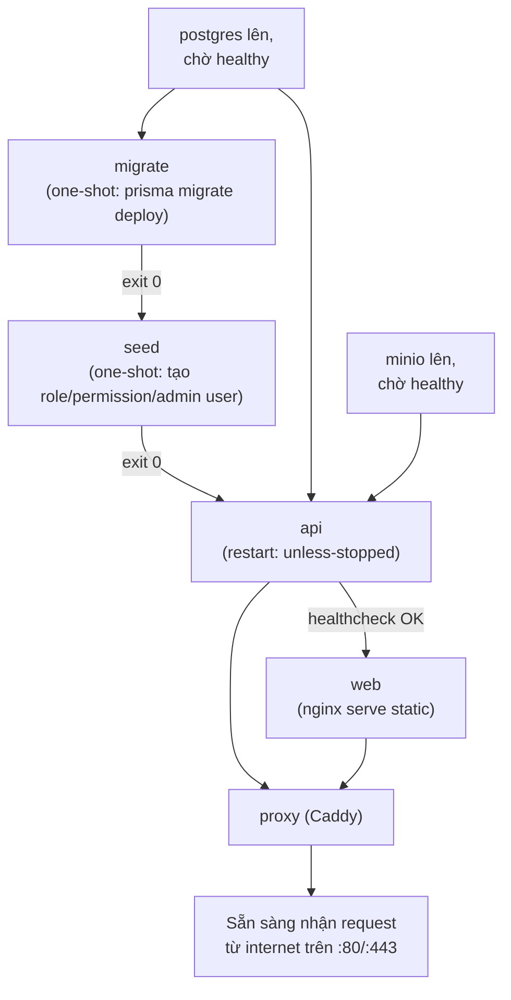
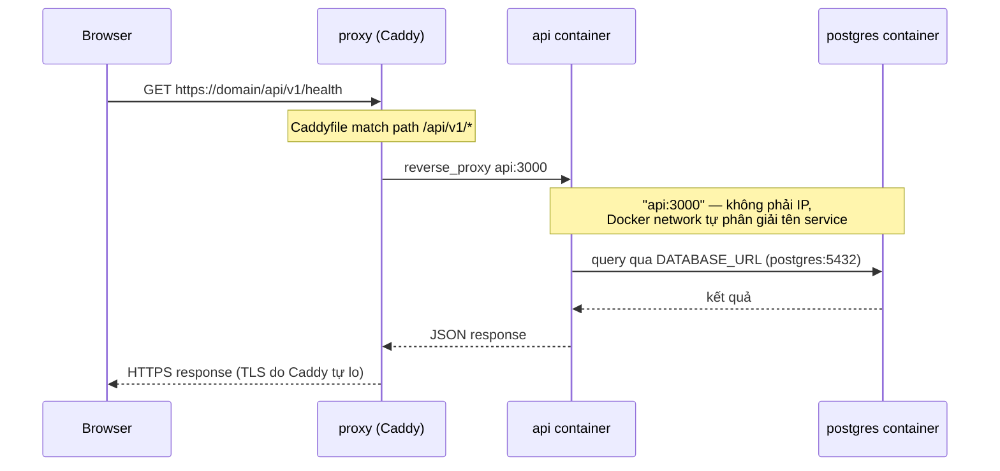

# Visual Explanation: Cơ chế chạy Web & Docker

## Overview

Dự án có **2 chế độ chạy hoàn toàn khác nhau**, dùng cho 2 mục đích khác nhau:

1. **Dev** (`pnpm dev`) — chạy trực tiếp trên máy bạn, không qua container, có live-reload để code xong thấy ngay.
2. **Prod** (`docker-compose.prod.yml`) — mọi thứ đóng gói vào **container** riêng biệt, chạy như một hệ thống thu nhỏ, giống hệt cách nó sẽ chạy trên server thật.

Container Docker không phải "1 máy ảo to" — mỗi service (`postgres`, `minio`, `api`, `web`, `proxy`...) là **1 tiến trình bị cô lập riêng**, có network riêng, chỉ nói chuyện với nhau qua tên service (`api`, `postgres`...) như tên miền nội bộ.

## Quick View (ASCII)

### Chế độ Dev — chạy thẳng trên máy, không container

```
Trình duyệt
   │  http://localhost:5173
   ▼
┌─────────────────────────┐        proxy /api/*        ┌──────────────────────┐
│ Vite Dev Server (web)   │ ──────────────────────────▶ │ NestJS (nest --watch)│
│ apps/web, HMR tự reload │                              │ apps/api, port 3000  │
└─────────────────────────┘                              └───────────┬──────────┘
                                                                      │
                                                     ┌────────────────┼────────────────┐
                                                     ▼                                 ▼
                                          Postgres :55432                     MinIO :59000/59001
                                          (chạy bằng docker-compose.yml — chỉ 2 service hạ tầng này
                                           mượn Docker, còn code api/web chạy trần trên máy)
```

### Chế độ Prod — mọi thứ là container, nối qua Docker network

```
                              Internet / trình duyệt
                                        │  https://domain (hoặc cloudflare tunnel)
                                        ▼
                         ╔══════════════════════════════╗
                         ║   proxy (Caddy) :80/:443      ║   ← DUY NHẤT container này
                         ║   TLS tự động + reverse proxy ║      lộ port ra ngoài
                         ╚═══════════════╦════════════════╝
                    /api/v1/* │                       │ mọi path khác
                              ▼                       ▼
                   ┌─────────────────┐      ┌──────────────────┐
                   │  api :3000      │      │  web :8080       │
                   │  (NestJS build) │      │  (nginx + file    │
                   │                 │      │   tĩnh đã build)  │
                   └────────┬────────┘      └──────────────────┘
                            │
              ┌─────────────┼─────────────┐
              ▼                           ▼
   ┌─────────────────┐         ┌─────────────────┐
   │ postgres :5432   │         │ minio :9000      │
   │ (không lộ ra host)│         │ (không lộ ra host)│
   └─────────────────┘         └─────────────────┘

   network "frontend" = { proxy, web, api }      ← api có chân ở CẢ 2 network
   network "backend"  = { api, postgres, minio }    (là cầu nối duy nhất)
```

## Detailed Flow

### 1. Thứ tự khởi động (docker-compose.prod.yml)



**Điểm quan trọng:** `migrate` và `seed` là container **one-shot** — chạy xong 1 lần rồi tắt hẳn (`restart: 'no'`), không phải service sống mãi như `api`/`web`. `depends_on ... condition: service_completed_successfully` đảm bảo `api` chỉ khởi động SAU KHI 2 job đó chạy xong, không phải chỉ "đã start".

### 2. Một request đi từ trình duyệt vào tận Postgres như thế nào



Nếu path KHÔNG khớp `/api/v1/*` (ví dụ `/`, `/tra-cuu`, `/assets/...`) → Caddy fallback sang `reverse_proxy web:8080` — trả file tĩnh (HTML/JS/CSS đã build sẵn của React).

## Key Concepts

1. **Dev không "build" gì cả** — `nest start --watch` chạy thẳng TypeScript (qua ts-node/SWC), Vite dev server serve file trực tiếp từ RAM, sửa code → tự động phản ánh trong 1-2 giây. Đây là lý do dev nhanh nhưng "không giống thật" 100%.

2. **Prod PHẢI build trước** — `docker/api.Dockerfile` và `docker/web.Dockerfile` là **multi-stage build**: stage 1 cài dependencies + biên dịch (`tsc` cho api ra `dist/`, `vite build` cho web ra file tĩnh), stage 2 chỉ copy đúng kết quả đã biên dịch vào image cuối cùng — không có source `.ts` trong image chạy thật, image nhẹ hơn và không lộ source.

3. **`image:` vs `build:` trong compose** — mỗi service vừa có `image: gthanh/app_tra_cuu:api-v1` vừa có `build: ...`. Nếu bạn gõ `docker compose up -d` (không có `--build`), Docker dùng thẳng `image:` đã pull sẵn từ Docker Hub — **không cần source code, không cần build**. Đây là lý do leader chỉ cần `docker compose pull && up -d` là chạy được, dù họ không có repo.

4. **2 network tách biệt = ranh giới bảo mật:**
   - `backend`: chỉ `postgres`, `minio`, `api` thấy nhau. Postgres/MinIO **không có `ports:`** nghĩa là không port nào của chúng lộ ra ngoài container, kể cả ra máy host — chỉ container khác trong network mới gọi được.
   - `frontend`: chỉ `proxy`, `web`, `api` thấy nhau.
   - `api` có mặt ở CẢ 2 network → nó là "cầu nối" duy nhất giữa vùng công khai và vùng dữ liệu nhạy cảm.
   - Chỉ `proxy` có `ports: ['80:80', '443:443']` → là **cửa duy nhất** thế giới bên ngoài chạm được vào hệ thống.

5. **Volume mount `./config:/repo/config:ro`** — file `config/config.json` được "gắn" (mount) trực tiếp từ máy host vào container `api`, không đóng gói cứng trong image. Sửa file này trên máy host + `docker compose restart api` là đủ để thêm datasource mới — không cần build lại image. `:ro` = read-only, container không tự sửa ngược lại file host.

6. **Cloudflare Tunnel (giải pháp tạm đang dùng)** — `cloudflared` chạy trên máy host (ngoài Docker), nó mở 1 kết nối ra ngoài tới Cloudflare, rồi forward request nhận được thẳng vào `https://localhost:443` — tức là gõ đúng cửa `proxy` (Caddy) y hệt như trình duyệt gõ trực tiếp. Vì vậy tunnel **phụ thuộc hoàn toàn vào máy này + Docker stack này còn chạy**; tắt máy là tunnel chết theo, khác với deploy thật lên VPS (Caddy chạy 24/7 trên server riêng, không phụ thuộc máy cá nhân).

## Code Example

`docker-compose.prod.yml` — điểm mấu chốt của 2 network và healthcheck-based ordering:

```yaml
api:
  image: gthanh/app_tra_cuu:api-v1
  depends_on:
    postgres: { condition: service_healthy }
    seed:      { condition: service_completed_successfully }
  networks: [backend, frontend]   # ← cầu nối 2 vùng

proxy:
  image: caddy:2.9-alpine
  ports: ['80:80', '443:443']     # ← DUY NHẤT container này lộ port ra host
  networks: [frontend]
```

`docker/Caddyfile` — định tuyến theo path, đây cũng là chỗ gây lỗi tunnel "trang trắng" (Host header không khớp `{$APP_DOMAIN}`):

```caddyfile
handle /api/v1/* {
	reverse_proxy api:3000
}
handle {
	reverse_proxy web:8080
}
```
